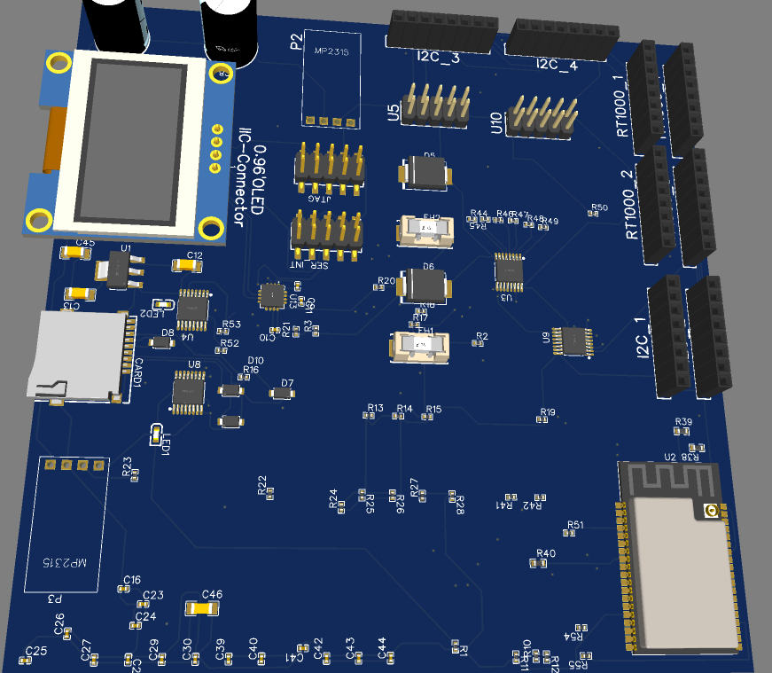
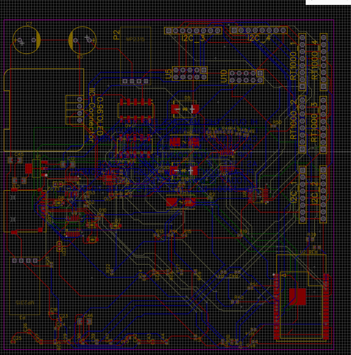
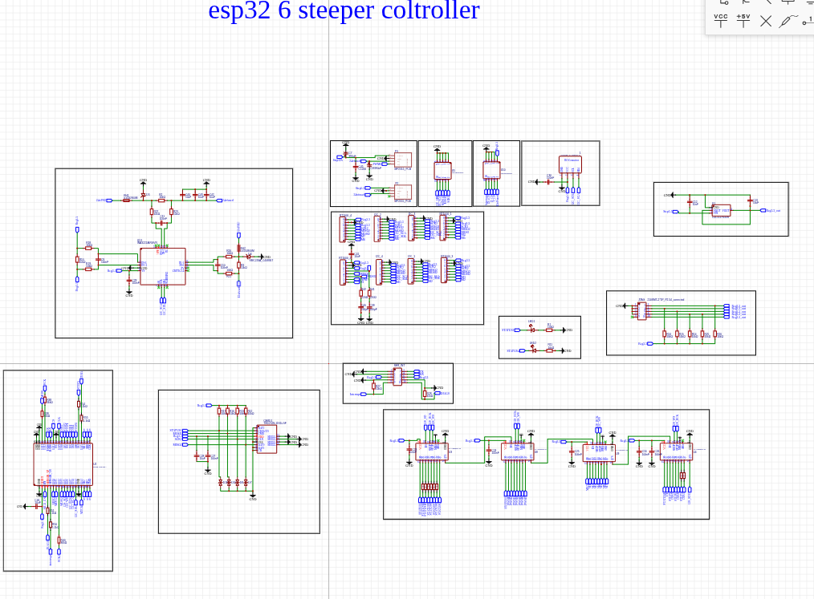

# ESP32 6-Stepper Controller

A custom ESP32 controller board designed to control multiple stepper motors, MOSFETs, servo motors, and display modules with dual power management and monitoring features.

## Demo Video

▶️ [Watch Project Demo](https://youtu.be/_5DIiYXrQXE)

## lapse link 1

▶️ [Watch lapse video](https://lapse.hackclub.com/timelapse/dXhGFAztCAz1)

## lapse link 2

▶️ [Watch lapse video](https://lapse.hackclub.com/timelapse/VzN-bGESYngy)

## Project Preview

### 3D PCB Representation

### PCB Layout

### Circuit Schematic

## Repository Structure

| Folder/File | Description |
|---|---|
| PCB source file/ | EasyEDA PCB project source |
| Gerber_esp32/ | PCB manufacturing files |
| schematic/ | Circuit schematic |
| OBJ_PCB/ | 3D PCB model |
| BOM.csv | Bill of Materials |
| image/ | Project images |
| README.md | Project documentation |

## PCB Design Files

Editable PCB design file:

`PCB source file/PCB_esp32-6.json`

## Bill of Materials (BOM)

The `BOM.csv` file contains component details, designators, quantities, footprints, and LCSC part numbers.

## How to Build Physically

### 1. Download the Project

Download gaber file

### 2. Open the Design

Open [EasyEDA](https://easyeda.com/) and import the gaber file.

### 3. Manufacture PCB

Upload the Gerber files to a PCB manufacturer and place your order.

### 4. Assemble the PCB

Assemble components using the schematic and BOM as references.

## Project Status

**ALPHA – UNTESTED**

The PCB design is currently in the alpha stage. It has not been physically manufactured, assembled, or tested.

All features are currently design targets and require hardware validation.

## Credits

- **Designed By:** Dipender
- **Project Name:** ESP32 6-Stepper Controller
- **Design Date:** 12 November 2026
